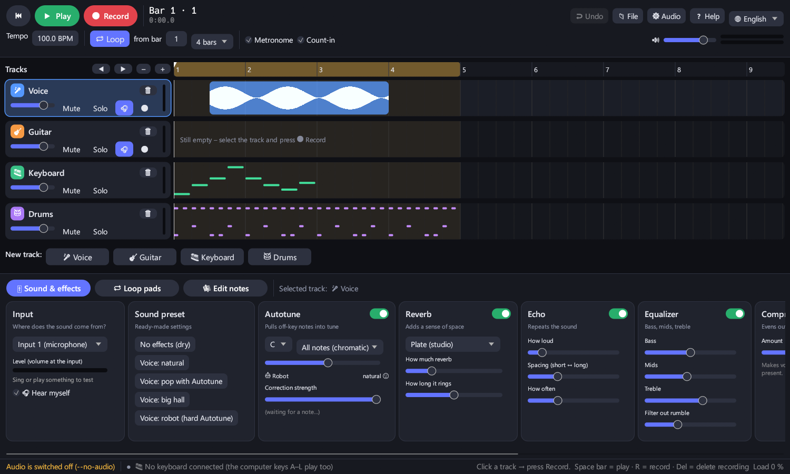
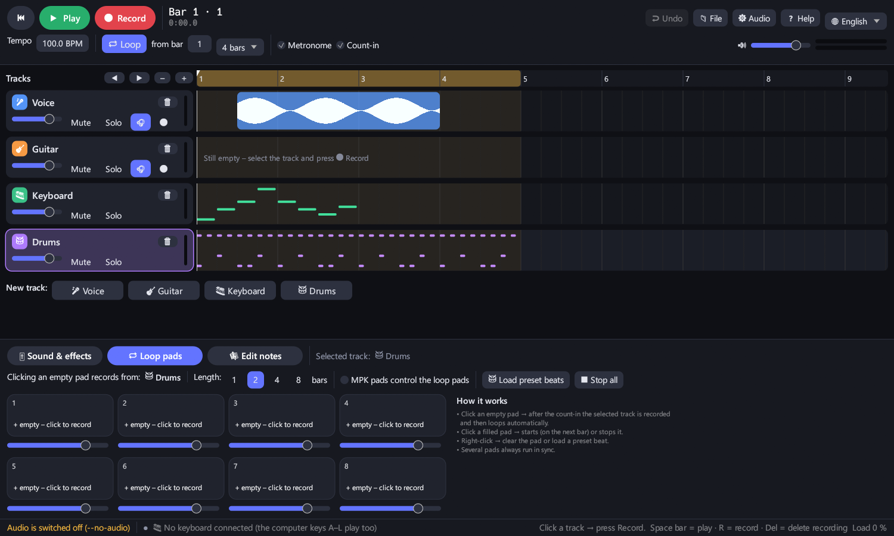
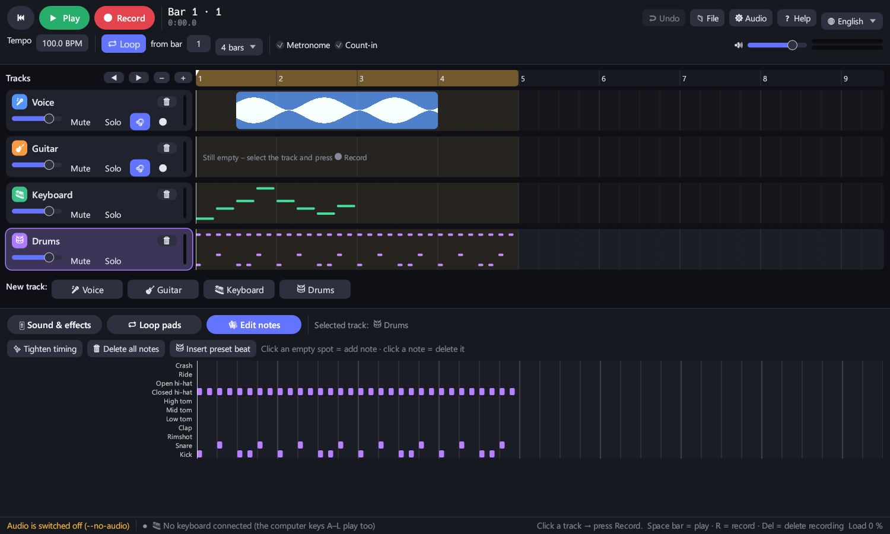
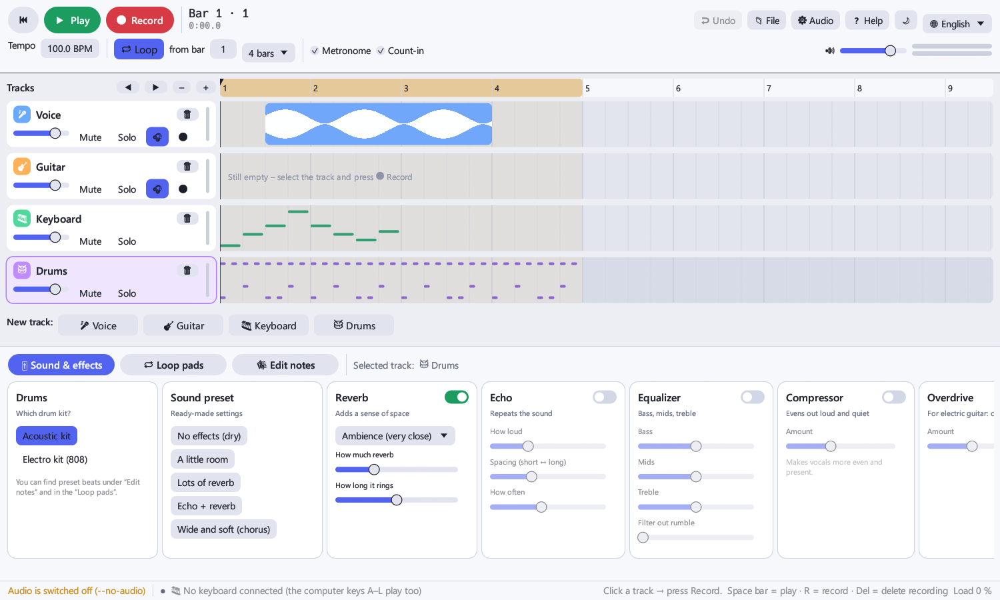
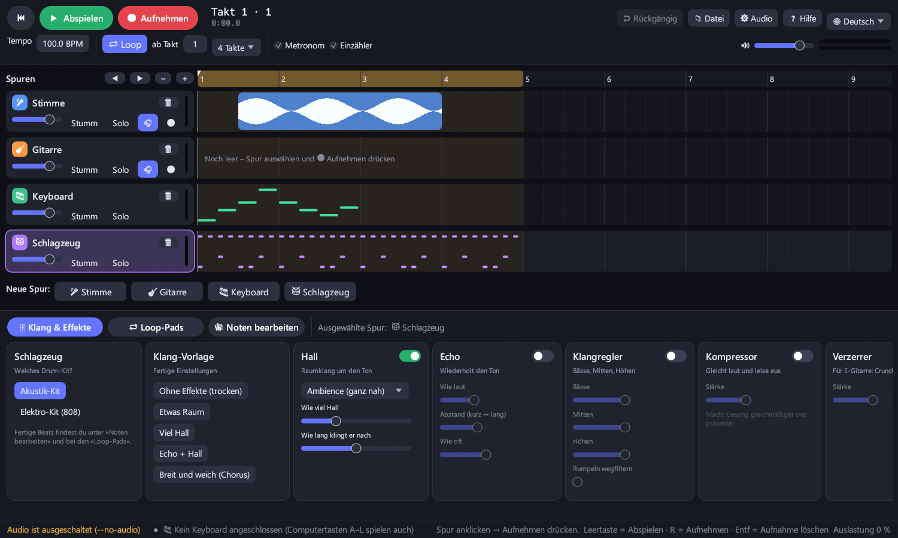

# GaragaBand

A simple, beginner-friendly music studio for Windows, written in Rust.
Record vocals and guitar, play synths and drums from a MIDI keyboard, layer loops and export the result as a WAV file — without having to learn a full-blown DAW.



> **Status:** `1.0.0-alpha` — usable, but expect rough edges. Bug reports and ideas are welcome.

## Download

**[⬇ Download the latest `GaragaBand.exe` from the Releases page](https://github.com/MatzunaTata/GaragaBand/releases)**

It is a single portable executable for Windows 10/11 (64-bit); there is nothing to install.
The file is not code-signed, so Windows SmartScreen may ask for confirmation on first start ("More info" → "Run anyway").

## Features

- **Multitrack recording** — voice and guitar tracks with live monitoring, waveform display, drag-to-move clips and undo
- **Built-in instruments** — a polyphonic synth with 10 sounds (piano, e-piano, organ, strings, pads, bass, bells …) and two synthesized drum kits
- **Autotune** — real-time pitch correction, from an inaudible touch-up to the full robot effect, with key and scale selection
- **Effects per track** — equalizer, compressor, overdrive, chorus, echo and four reverb types, plus one-click sound presets
- **Loop mode** — repeat a section and layer a new take on every pass
- **Loop pads** — 8 pads for bar-synced loops, recorded live or filled with preset drum beats
- **Note editor** — piano roll / drum grid with quantize and ready-made beats
- **Works with your hardware** — any audio device Windows knows (Focusrite, Behringer, PreSonus, Steinberg, on-board sound, USB microphones …) with up to 8 selectable inputs; no special driver needed
- **Low latency** — WASAPI exclusive mode with automatic fallback to shared mode
- **MIDI** — plug-and-play for any class-compliant keyboard or pad controller; keys play the synth, pads (MIDI channel 10) play the drums
- **English and German** user interface, switchable at any time
- **Dark and light theme** — switch with the ☀ / 🌙 button in the top bar
- **Save, load and export** — projects as a JSON file plus WAV clips, final mix as 24-bit WAV

## Screenshots

| Loop pads | Note editor |
| --- | --- |
|  |  |

The light theme:



The interface in German:



## Getting started

1. Plug in your headphones and your microphone/guitar. GaragaBand picks a USB audio interface automatically if it recognises one and otherwise uses the Windows default devices (change this under **⚙ Audio**).
2. Click the track you want to record on, press **⏺ Record** and start after the count-in.
3. Press **⏹ Stop** (or the space bar). Not happy? **↩ Undo**.
4. Shape the sound under **Sound & effects**, then use **📁 File → Export as audio file** to get a WAV.

No MIDI keyboard? The computer keys `A S D F G H J K` (and `W E T Y U` for the black keys) play the selected instrument.

| Key | Action |
| --- | --- |
| `Space` | Play / stop |
| `R` | Record / stop recording |
| `Del` | Delete the selected recording |
| `Ctrl+Z` | Undo |
| `Ctrl+S` | Save |
| `Ctrl` + mouse wheel | Zoom the timeline |

The built-in help (**❓ Help**) explains everything step by step.

## Building from source

You need the [Rust toolchain](https://rustup.rs) on Windows (the audio back end uses WASAPI, so other platforms are not supported).

```bash
git clone https://github.com/MatzunaTata/GaragaBand.git
```

```bash
cargo run --release
```

```bash
cargo test
```

Useful flags for development: `--no-audio` (do not open an audio device), `--demo` (start with demo content), `--lang en|de`, `--theme dark|light`, `--tab sound|pads|notes`, `--audio-test <file>` (silent device test that writes a report).

## Project layout

```
src/
├── main.rs        entry point and command line flags
├── i18n.rs        English/German text layer
├── project.rs     save, load, WAV export
├── audio/         WASAPI device I/O and MIDI input
├── dsp/           synth, drum kit, effects, autotune
├── engine/        tracks, transport, recording, loop pads, mixer
└── ui/            egui user interface (theme, widgets, panels)
```

The audio thread and the UI share the engine behind a mutex. The UI never holds the lock for long: each frame it takes a snapshot, draws from it and writes changes back.

## Releases

Releases are built automatically by [GitHub Actions](.github/workflows/release.yml) on every push to `main`. The version comes from `Cargo.toml`:

- a new version number creates a new release `v<version>` with the executable attached,
- pre-release versions such as `1.0.0-alpha` are rolling — the release is rebuilt from the latest commit,
- stable versions are never overwritten; bump the version to publish the next one.

## Contributing

Contributions are welcome — bug fixes, new sounds, translations, anything.

1. Fork the repository and create a branch.
2. Make sure `cargo test` passes and `cargo build` is free of warnings.
3. User-visible texts go through `tr("English", "Deutsch")` so that both languages stay complete.
4. Open a pull request.

## License

[MIT](LICENSE) — you may use, modify and redistribute GaragaBand freely.
